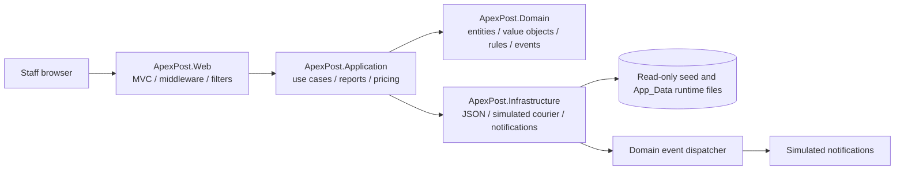
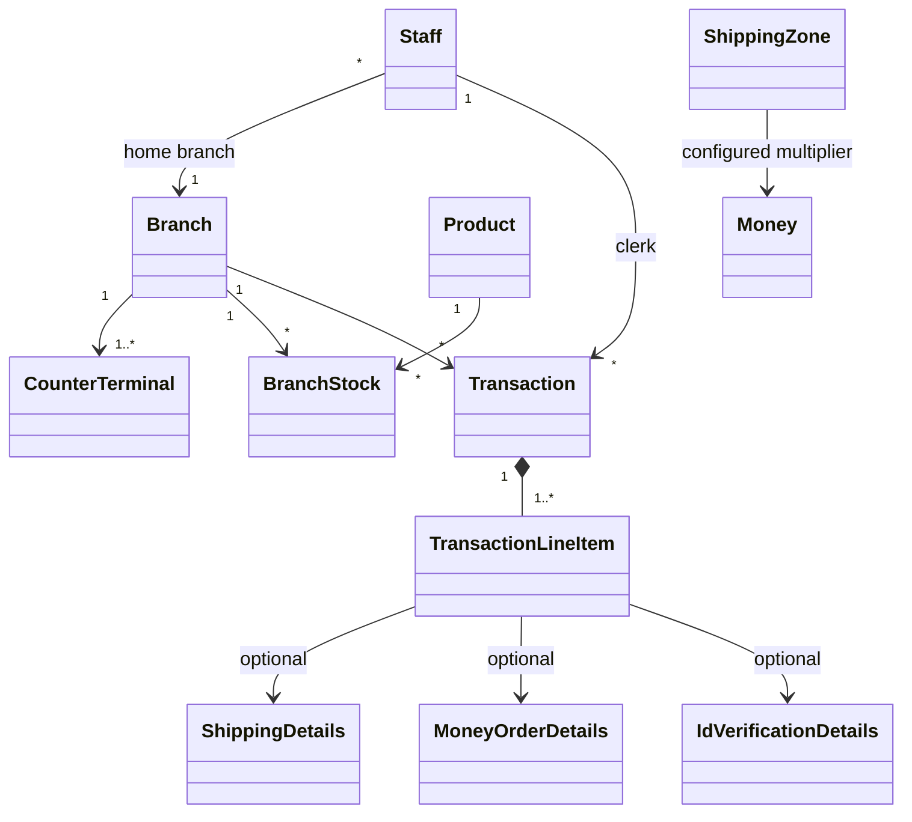

# ApexPost architecture and design decisions

## Architecture

The Week 1 layered architecture survived the domain change; the TechNova entities and behaviors were replaced with ApexPost branch, staff, stock, shipping, money-order, identity-verification, and transaction models. The Web project is a new presentation layer. The repository interfaces remain in Application so JSON persistence can be replaced without moving business rules.

### Domain model

Entities own identity and lifecycle: `Branch`, `Staff`, `Product`, `BranchStock`, `Transaction`, and `ShippingZone`. `Money`, `Weight`, `Dimensions`, `BranchCode`, `Sku`, `Address`, `ShippingDetails`, `MoneyOrderDetails`, and `IdVerificationDetails` are value-oriented data. `TransactionLineItem` uses composition plus a typed discriminator (`LineItemType`) so one basket can mix retail and postal/financial services without an inheritance tree.

The diagram's `CounterTerminal` represents a terminal ID stored on its branch; it is not currently a separate persistence entity.

## Middleware pipeline

The pipeline order is deliberate:

1. `UseForwardedHeaders` accepts only headers from the framework's trusted proxy list. `ForwardedHeaders:KnownProxies` can add explicitly trusted proxy IPs; it must run before anything that reads the client IP or scheme.
2. `UseHsts` (non-Development) adds browser HTTPS enforcement using the effective scheme.
3. `RequestCorrelationMiddleware` validates or generates `X-Correlation-Id`, opens a logging scope, and sets the response header in `OnStarting` so it survives the exception handler's `Response.Clear()`. It is first so every later log line carries the ID (`Logging:Console:IncludeScopes` is on).
4. `RequestLoggingMiddleware` logs method, path and final status in `finally`. It sits **outside** the exception boundary, so a failed request is logged as 500 rather than the default 200.
5. `RequestTimingMiddleware` measures every request in `finally`, also outside the exception boundary, and warns above `Performance:SlowRequestThresholdMs`.
6. `GlobalExceptionMiddleware` turns any failure below it into safe Problem Details with the trace ID. A client-cancelled request is logged as cancellation and recorded as 499, never as a failure.
7. `SecurityHeadersMiddleware` sets CSP, `X-Content-Type-Options`, `X-Frame-Options` and `Referrer-Policy` in `OnStarting`, so error responses get them too.
8. `MaintenanceModeMiddleware` returns 503 and `Retry-After`, except for `/health`.
9. `UseRequestLocalization` sets the supported `en-AU` culture.
10. `UseResponseCompression` compresses eligible responses (not HTTPS responses by default).
11. `UseStatusCodePages` supplies bodies for otherwise-empty HTTP error statuses.
12. `UseCookiePolicy` applies secure, HttpOnly, strict-same-site cookie requirements.
13. `UseHttpsRedirection` runs before static content can be served over HTTP.
14. `UseStaticFiles` serves local CSS/JavaScript without authentication or MVC work.
15. `UseRouting` selects the endpoint so metadata-aware middleware can read its attributes.
16. `UseCors` applies the named widget policy from endpoint metadata, and answers preflight before any credential check.
17. `IpRestrictionMiddleware` checks the post-forwarding client IP against `Security:AllowedIps` for `[IpRestricted]` endpoints. It runs before rate limiting and key checks: a blocked address always gets 403, learns nothing about key validity, and costs no quota.
18. `UseRateLimiter` enforces the login and per-partner fixed windows; partners get independent partitions by partner ID, never by key value.
19. `ApiKeyAuthenticationMiddleware` protects `[ApiKeyRequired]` endpoints. Keys are SHA-256 hashed and compared in constant time, returning 401 for missing or invalid keys and 500 if none is configured.
20. `UseAuthentication` validates the staff cookie.
21. `UseAuthorization` evaluates role and branch policies. `AuditingAuthorizationResultHandler` audits denied business actions, and a forbidden signed-in user receives 403 rather than a login redirect.
22. `UseAntiforgery` applies endpoint antiforgery metadata; MVC also validates every unsafe request through the global `AutoValidateAntiforgeryToken` filter.
23. `MapHealthChecks("/health")` and the conventional `{controller=Home}/{action=Index}/{id?}` route register the endpoints.

The default forwarded-header trust list is deliberately not cleared. A deployment behind a proxy must configure its exact proxy addresses; trusting arbitrary forwarding headers permits IP spoofing and can bypass the partner allowlist. CORS only restricts browser JavaScript and does not authenticate non-browser callers; API-key and IP controls remain necessary.

## Middleware versus MVC filters

| Concern | Placement | Reason |
|---|---|---|
| Correlation ID, request logs/timing, exception boundary | Middleware | Must include routing, static files, health checks, MVC, and errors. |
| HSTS, HTTPS, security headers, compression, cookies, CORS | Built-in/custom middleware | Operates on the HTTP transport and response headers. |
| Maintenance, API key, IP restriction, rate limiting | Middleware | Rejects requests before controller work; API-key middleware uses endpoint metadata after routing. |
| Audit trail | `AuditActionFilter` (`IAsyncActionFilter`), only for actions marked `[AuditedAction]` | Needs MVC action metadata, arguments and the action result. Limiting it to business actions keeps the log meaningful. |
| Denied business actions | `AuditingAuthorizationResultHandler` | Authorization rejects before MVC filters run, so a filter cannot see these attempts. |
| Model-state consistency | `ValidationActionFilter` on stock adjustment; explicit MVC checks on form controllers | Stock is a request endpoint with a consistent BadRequest response; staff, counter, and shipping forms redisplay with validation errors and repopulated choices. |
| Slow-action warning | `PerformanceActionFilter` | Measures MVC action execution and uses the configurable action threshold. |

Audit and performance filters are globally registered through DI. The audit filter acts only on actions marked `[AuditedAction("...")]`: sales (including money orders and identity checks), voids, refunds, stock adjustments, and staff, branch and product changes. GET pages and anonymous pages are not audited. Each entry holds the business action, a small allowlist of safe arguments, and non-sensitive details the controller adds explicitly (transaction ID, counter, line count, money order amount, whether an identity check ran, payment method). It never serialises models, request bodies, reasons, sender or recipient names, document numbers or passwords. A failed audit write is logged as an error and never changes the outcome of the completed business action.

The validation filter is applied with `ServiceFilter` to stock adjustment, where a Problem Details BadRequest is the right response. Staff, branch, product, counter and shipping forms redisplay themselves with their errors, because they must also repopulate choices.

## Data, async work, and lifetimes

- All runtime data lives in one folder, `Persistence:DataDirectory` (default `App_Data` under the content root, ignored by Git). Repositories read the read-only seed from the output `Data` folder until their first write creates the runtime file, so a clean or rebuild cannot wipe data. The audit log is in the same folder. Next week's database can replace this through `AddJsonPersistence` alone.
- `IRepository<TEntity, TId>` provides JSON persistence and locked `UpdateAsync` operations. Stock decrement is performed under the repository's `SemaphoreSlim`, preventing concurrent requests in this app process from taking the same last unit. JSON replacement is written to a same-directory temporary file and then renamed so an interrupted write does not truncate the previous file.
- Checkout persists an open transaction marker, reserves stock atomically, validates/completes the transaction, and then persists it as paid. Failures before the paid save compensate stock reservations and remove the open marker; failures during compensation are surfaced as an aggregate error for reconciliation. This is a single-process JSON workflow, not a cross-process database transaction.
- Stock adjustments are limited to active branch managers, require a signed quantity and a reason code, use the locked stock repository update, and emit low-stock events. The audit filter records SKU, quantity delta, and reason code without free-form reason text.
- Voids and refunds restock retail quantities. Each stock row records reversal transaction IDs under the same per-file update lock, making each row's restock idempotent if reversal processing is retried after a partial failure. The transaction remains marked as pending until all rows are updated; this does not provide multi-file crash atomicity or cross-process transactions.
- `StaffManagementService` owns staff creation, update, duplicate-email validation, branch validation, ID allocation, and deactivation. Its singleton semaphore serializes these workflows within one application process; JSON file locks and this semaphore do not coordinate multiple application instances.
- Transaction status, payment method, and reversal metadata have explicit `JsonInclude` annotations so private setters are restored during JSON deserialization. This is required for historical paid transactions to remain paid in reports and for reversal authorization/state checks to work after reload.
- Identity checks use an explicitly simulated format validator, not an external or government identity provider. The clerk no longer supplies the success result. Only masked last-four details and the result are added to the transaction.
- Reads/writes use asynchronous stream APIs and propagate `CancellationToken`; repository locks and simulated courier concurrency are bounded with `SemaphoreSlim`.
- Dashboard branch/product/transaction/stock reads are independent, so `Task.WhenAll` overlaps them.
- The product catalogue uses `IMemoryCache` with a five-minute TTL, `ValueTask`, and a single-flight semaphore. `ProductCataloguePerformanceTests` issues 10,000 reads against 30 products and deterministically observes one cached backing load versus 10,000 uncached loads. Elapsed time is diagnostic only; this in-memory test is not a disk-throughput benchmark.
- The low-stock threshold has one home: the `LowStockRule` object, configured by `Inventory:LowStockThreshold`.
- Notifications are stored per branch, so low-stock, high-value and void/refund alerts all reach that branch's dashboard, which reads them alongside its other data.
- Low-stock events are queued after stock reservation; transaction-completion, high-value money-order, low-stock, and void/refund notifications are dispatched after the relevant transaction state is persisted. These in-process notifications are not a durable outbox.
- Scoped MVC/report/transaction services are resolved per request. JSON repositories, audit store, catalogue cache, courier-rate service, notification service, event dispatcher, and the staff, branch and product management services are singletons; these contain no scoped dependencies. Middleware constructors receive only singleton-safe configuration/loggers; scoped application services are not captured by middleware.
- The data folder must be writable; the seed folder never changes. The audit store is append-only JSON Lines (`audit-log.jsonl`); `AUDIT-SAMPLE.json` is a readable sample.
- Branch opening hours are interpreted in each branch's configured `TimeZoneId`. Seed branches use their Australian region timezone; deployment data must keep that timezone accurate.
- The simulated courier tracking lookup applies a linked timeout token. Its timeout is distinct from caller cancellation; this exercises the cancellation contract without claiming a real courier integration.

## Advanced C# 14 usage

| Feature | Where it solves a real problem |
|---|---|
| Records and value objects | Shipping/order details, line items, audit rows, money/weight/SKU/branch codes prevent primitive-only domain APIs. |
| Pattern matching | Shipping service/parcel pricing, tax categories, event dispatch, and role-sensitive behavior. |
| C# 14 extension members and `field` | `extension(Transaction)` gives `RetailTotal` and `ServicesTotal`, which the daily sales report uses; `extension(Money)` gives a rounding helper; the `Money.Amount` backing field validates and rounds on assignment. |
| Generic constraints and repository abstraction | `IRepository<TEntity, TId> where TEntity : Entity<TId> where TId : notnull` gives typed keys, so a wrong ID type no longer compiles and no reflection is needed. `ISpecification<T>` and `FindAsync` keep report filters reusable. |
| `Predicate<T>` and `Func<T, bool>` | The low-stock report accepts an optional predicate while keeping the branch filter enforced separately. |
| `Func<ShippingDetails, decimal, Money>` | The tiered pricing strategy accepts an injectable pricing rule; the configured default keeps zone multipliers and parcel weight surcharge explicit while tests can substitute a business rule. |
| Custom attribute and cached reflection validator | `[NotBlank]` validates transaction line-item descriptions; `DomainAttributeValidator` caches the annotated property metadata per type. |
| Domain events | Transaction completion, money-order issue, stock-low, and void/refund events are dispatched to notification handlers after persistence. |
| Async/await and cancellation | MVC, application, repository, audit, cache, and rate lookups pass cancellation through asynchronous I/O. |
| `Task.WhenAll` | Independent dashboard reads are awaited together. |
| `SemaphoreSlim` | Bounds JSON writes/updates, audit appends, catalogue cache fills, and simulated courier quote concurrency. |
| `ValueTask` and cache | Hot catalogue reads return synchronously from memory; cache fills remain asynchronous and coalesced. |
| Cancellation versus timeout | Simulated courier tracking uses a linked timeout token and returns a distinct timeout failure; caller cancellation remains cancellation and is not reported as a timeout. |

There is intentionally no `Thread.Sleep`, `.Wait()`, or `.Result` in the solution.

The tracking timeout and simulated latency are configured with `CourierTracking:TimeoutMs` and `CourierTracking:SimulatedDelayMs`. A timeout returns HTTP 504 at the partner endpoint; a caller cancellation is not transformed into a successful or timeout response. The default parcel surcharge is configured with `ShippingPricing:ParcelWeightSurchargePerKilogram`; the pricing strategy validates that it is non-negative at startup.

## Reports

1. Daily paid branch sales split into retail and service totals (including tax), using each branch's local calendar day.
2. Low stock by branch/SKU (threshold 5).
3. Shipping volume by zone and service level.
4. Money-order and verification counts by branch, available through the auditor-only report.

## ADRs

Each decision records its context, the decision, the alternatives considered and the consequences.

### ADR-01: Keep the layered architecture, replace the domain

**Context:** The domain moved from TechNova resource management to postal retail, and every later week builds on this solution.

**Decision:** Keep the Domain, Application, Infrastructure and Web layers. Replace the TechNova entities and add MVC as the new presentation layer.

**Alternatives:** Rewrite as vertical slices (little benefit at this size); keep one project (business rules would leak into MVC).

**Consequences:** Dependencies still point inward, so the database and API work can replace outer layers. The cost is more mapping between layers.

### ADR-02: Compose mixed baskets with typed line items

**Context:** One basket must hold retail goods, shipping, money orders and identity checks, and be saved as JSON.

**Decision:** `TransactionLineItem` is one record with a `LineItemType` and optional detail records, validated by a switch in `AddLineItem`. `LineItems` is read-only, so `AddLineItem` is the only way in.

**Alternatives:** An inheritance tree (polymorphic JSON and more types for little behaviour); separate lists per kind (awkward totals and ordering).

**Consequences:** Totals and reports treat every line alike. Optional fields can disagree with the type, which `AddLineItem` guards against.

### ADR-03: Represent core measures as value objects

**Context:** Plain decimals and strings make it easy to mix up amounts, weights and codes.

**Decision:** Use `Money`, `Weight`, `Dimensions`, `Sku`, `BranchCode` and `Address` as records, with validation in one place.

**Alternatives:** Primitives with validation in services (rules get duplicated and skipped).

**Consequences:** Signatures document themselves and mixed currencies throw. Forms and JSON need small conversions.

### ADR-04: Use a pricing strategy plus JSON-backed zone rates

**Context:** Prices depend on parcel or letter, service level, weight and zone, and the rules will change. Weight limits differ too.

**Decision:** `IPricingStrategy` holds base rates and limits using tuple pattern matching, with an injectable `Func` for the price rule and zone multipliers from JSON. Parcels have service-level limits and need dimensions; letters have a 0.5 kg limit and need none. Tax categories are applied by `Money.CalculateTax`.

**Alternatives:** Rates in `if` chains inside the service (hard to test); a full rules engine (too heavy for six base rates).

**Consequences:** Rules can be tested and replaced alone. Unknown zones fail rather than getting a fallback price. Tax rates remain in code until a later week needs them configurable.

### ADR-05: Keep JSON behind repositories during Week 2

**Context:** No database is allowed this week, but next week's database must not disturb business logic.

**Decision:** Keep async JSON repositories behind `IRepository<TEntity, TId>`, registered only through `AddJsonPersistence`.

**Alternatives:** Direct file access from services (blocks the swap); an in-memory store (loses persistence).

**Consequences:** The database change stays in Infrastructure. Whole-file reads and writes are slow at scale and only safe in one process.

### ADR-06: Use custom cookie authentication with per-staff password hashes

**Context:** The assignment forbids ASP.NET Core Identity and secrets in source. The first version had one shared password committed in `appsettings.json`.

**Decision:** Each `Staff` record stores a salted PBKDF2-SHA256 hash (600,000 iterations) from `IPasswordHasher`, using only the base class library. `StaffAuthenticationService` verifies it, doing the same work for unknown emails. Cookies carry `StaffId`, `Role` and `BranchCode`.

**Alternatives:** ASP.NET Core Identity (not allowed); a shared password from user-secrets (no individual accountability); fast hashes such as SHA-256 alone (easy to brute force).

**Consequences:** Logins are accountable to one person and no usable password is stored. Seed hashes belong to documented demo accounts that must never reach production. The old shared password stays in Git history but no longer works anywhere.

### ADR-07: Separate transport middleware from MVC filters

**Context:** Each cross-cutting concern could sit in either place.

**Decision:** Anything needed for every request, or before routing to MVC, is middleware. Anything needing action metadata, arguments, model state or results is a filter.

**Alternatives:** All middleware (no model state or action result); all filters (would miss static files, health checks and pre-MVC failures).

**Consequences:** Each concern has one obvious home. Authorization denials happen before filters, which ADR-20 handles.

### ADR-08: Append audit records and minimise personal data

**Context:** Business actions must be traceable to a person, branch, time and correlation ID without storing sensitive data.

**Decision:** Write append-only JSON Lines behind `IAuditStore`, using allowlisted values only.

**Alternatives:** Serialising whole request models (leaks personal data sooner or later); only application logs (not a dedicated, queryable trail).

**Consequences:** Appends are cheap and history is not rewritten. File permissions remain a deployment responsibility, and a database store can replace it next week.

### ADR-09: Bound concurrency and cache hot reads

**Context:** Unbounded file and courier access would cause contention, and the catalogue is read constantly.

**Decision:** Use `SemaphoreSlim` per file and for courier rates, `Task.WhenAll` for independent reads, and `ValueTask` with `IMemoryCache` for the catalogue, invalidated when a product changes. A test shows 10,000 reads cause one load.

**Alternatives:** A global lock (slows unrelated data); an external cache (not allowed and unnecessary).

**Consequences:** Concurrent sales were confirmed safe under load. Locks only work within one process.

### ADR-10: Compensate JSON checkout reservations

**Context:** JSON files cannot offer a transaction across stock and sales.

**Decision:** Save an open marker, reserve stock under the repository lock, and mark paid last. On failure, restore reservations and delete the marker; surface a rollback failure for reconciliation.

**Alternatives:** Validate then write without compensation (partial failures lose stock); a hand-written transaction log (too complex for one week).

**Consequences:** Normal failures leave stock correct. A process crash can still need reconciliation until a database transaction replaces this.

### ADR-11: Verify document format through a replaceable simulation

**Context:** No real identity provider exists, and clerks must not be able to mark a check as passed themselves.

**Decision:** `IIdentityVerificationService` decides the result. Only a masked last-four value is kept, and numbers of four characters or fewer are refused because masking could not hide them.

**Alternatives:** A clerk tick box (bypasses the rule); keeping encrypted numbers (risk with no benefit).

**Consequences:** A provider can be plugged in later. The current check validates format only and is labelled as simulated in the UI.

### ADR-12: Restock voided and refunded goods idempotently

**Context:** Reversals touch several files and may be retried after a partial failure. A concurrent void and refund must not both succeed.

**Decision:** The status change runs inside the repository's locked update. Each stock row records reversal IDs it has restocked, and the transaction is flagged only when all rows are done.

**Alternatives:** Restock without markers (retries double count); no restocking (stock drifts from reality).

**Consequences:** Retries are safe and one reversal wins. Stock rows hold small extra history, which a database can move to a table.

### ADR-13: Process trusted proxy metadata before HSTS

**Context:** Behind a TLS proxy the app must know the real scheme and client IP, yet forwarded headers can be spoofed.

**Decision:** Run forwarded headers first and accept them only from configured proxies, with a limit of one hop.

**Alternatives:** Parse `X-Forwarded-For` in the IP middleware (spoofable); trust all proxies (bypasses the allowlist).

**Consequences:** Allowlist decisions are reliable, but each deployment must configure its exact proxy addresses.

### ADR-14: Keep management rules in services and serialise local writes

**Context:** Staff, branch and product changes have uniqueness, reference and ID rules. Without management screens, branches and products could not be changed at all.

**Decision:** `StaffManagementService`, `BranchManagementService` and `ProductManagementService` own these rules behind singleton semaphores, with thin administrator-only controllers. New branches and products get zero-quantity stock rows.

**Alternatives:** Rules in controllers (violates the brief); relying only on the per-file lock (does not cover check-then-write across files).

**Consequences:** Rules are testable and controllers stay thin. The semaphores are not distributed locks; database constraints replace them later.

### ADR-15: Make pricing rules replaceable and JSON state round-trip safe

**Context:** Private setters protect entities, but JSON would silently reset them to defaults on load.

**Decision:** Mark state with `[JsonInclude]`, keep `Func` pricing rules injectable, and bind the parcel surcharge from configuration.

**Alternatives:** Public setters (rules can be bypassed); separate storage models (a lot of mapping for one week).

**Consequences:** Paid transactions stay paid after reload, with tests proving it. Entities carry a serialisation attribute until the database mapping arrives.

### ADR-16: Type repository keys and add specifications

**Context:** `IRepository<T>` took `object id` and used reflection on each call, so wrong ID types failed silently at runtime.

**Decision:** Use `IRepository<TEntity, TId>` constrained to `Entity<TId>`, plus `ISpecification<T>` and a `FindAsync` extension for report filters.

**Alternatives:** Keep `object` (no compile-time safety); a separate repository per entity (repeats code).

**Consequences:** Wrong key types no longer compile and reflection is gone. Specifications run in memory for now; the database work may want expression-based ones.

### ADR-17: Use conventional routing for MVC, attribute routing only for partners

**Context:** The brief asks for conventional routing, yet actions had hard-coded attribute routes.

**Decision:** MVC actions use `{controller=Home}/{action=Index}/{id?}` with only `[HttpGet]` and `[HttpPost]`. `/integration/parcel-status` keeps its attribute route because partners depend on that exact public URL and `[ApiController]` requires one.

**Alternatives:** Attribute routes everywhere (against the brief, and URLs drift from controller names); a conventional partner URL (ties a public contract to a class name).

**Consequences:** URLs are predictable. The shipping label moved to `/Shipping/ShippingLabel`, so old bookmarks to `/Counter/ShippingLabel` return 404.

### ADR-18: Keep one configurable data folder with a read-only seed

**Context:** Repositories wrote to `bin/.../Data`, so a clean or rebuild wiped data, while the audit log lived elsewhere and was committed by accident.

**Decision:** Use `Persistence:DataDirectory` for all runtime files. Seed files stay read-only in the output, and the runtime folder is ignored by Git.

**Alternatives:** Writing to the source tree (dirty Git and committed logs); a separate setting per store (easy to scatter again).

**Consequences:** Data survives rebuilds and tests can use a temporary folder. To reset the demo, delete `App_Data`.

### ADR-19: Log outside the exception boundary

**Context:** Logging and timing ran inside the exception handler, so failures were recorded with status 200 before the handler changed it to 500.

**Decision:** Order the pipeline as correlation, logging, timing, then exception handling, and set the correlation header in `OnStarting`.

**Alternatives:** Record 500 by catching in the logging middleware (duplicates the handler's knowledge).

**Consequences:** Logs show the status the client received, and error responses keep their correlation ID. Exceptions thrown by the logging middleware itself would not become Problem Details, so it is kept minimal.

### ADR-20: Audit business actions only, and never let auditing fail them

**Context:** Auditing every action buried the important records in page views, and a failed audit write could turn a completed sale into a 500.

**Decision:** Mark business actions with `[AuditedAction]`, catch and log audit write failures, and record policy denials in `AuditingAuthorizationResultHandler`.

**Alternatives:** A separate `ServiceFilter` per action (easy to forget and no business name); failing the request when auditing fails (the sale has already happened, so reporting failure would mislead the clerk).

**Consequences:** The log is short and useful, and denied attempts are visible. A lost audit entry is possible during a disk failure, but it raises an error log for follow-up.

## SOLID mapping

- **Single Responsibility:** Domain rules, orchestration, JSON I/O, MVC transport, and audit each live in their own layer/service.
- **Open/Closed:** `IPricingStrategy`, repository interfaces, event dispatcher, and notification interface permit alternate pricing, storage, or notification implementations.
- **Liskov Substitution:** JSON repositories implement the same `IRepository<T>` async contract and can be substituted with database repositories.
- **Interface Segregation:** Catalogue, audit, courier-rate, notification, and repository consumers depend on focused interfaces.
- **Dependency Inversion:** Application use cases depend on repository/rate/event contracts; Web composes Infrastructure implementations in `Program.cs`.

## Security and audit threats / mitigations

| Threat | Mitigation |
|---|---|
| Password/API-key disclosure | No passwords or keys in configuration files; partner keys come from user-secrets or a secret store. Staff passwords are stored only as salted PBKDF2 hashes, and hashes are never shown or audited. |
| Account enumeration | The same failure message and the same hashing work for unknown emails, inactive staff and wrong passwords. |
| Brute-force login / partner overload | Per-IP login fixed window (3/minute); authenticated partner partition limit (60/minute); 429 and `Retry-After`. |
| Forged state-changing form requests | Antiforgery token validation for every MVC POST; strict, Secure, HttpOnly auth cookies. |
| Unauthorized counter/financial actions | Staff role/branch claims, manager/auditor/admin policies, a 403 for denied users, `SameBranchOnly` on branch-scoped reports, domain-side active staff and branch checks, and audit entries for denied attempts. |
| Stock race or negative balance | Locked atomic repository update and domain guard. |
| ID-document disclosure | Only masked last-four data is persisted on verification details; request payloads are not audited/logged. |
| API-key timing/transport abuse | Fixed-time comparison of hashes (which also hides key length), header-only credential, HTTPS, configured key requirement, partner IP allowlist, rate limiting. |
| Forwarded-IP spoofing | Forwarded headers processed only from trusted proxies; do not trust arbitrary `X-Forwarded-For`; maintain exact known-proxy and allowed-client lists. |
| Browser cross-origin misuse / clickjacking / MIME sniffing | Single approved CORS origin, CSP, frame denial, `nosniff`, Referrer-Policy. CORS is explicitly not treated as API authentication. |
| Error detail leakage / untraceable failures | Safe Problem Details with correlation trace ID; exception details stay in server logs. |
| Audit tampering and excess PII | Append-only JSONL writes behind `IAuditStore`; no sensitive form data in entries; operational file access remains a deployment responsibility. |

## Validation

`ApexPost.Test` has 86 tests. Unit tests cover stock, identity verification and masking, parcel and letter weight limits, pricing, currency consistency, branch hours, JSON round trips, checkout compensation, idempotent reversals, password hashing, the low-stock rule, read-only line items and seed handling. WebApplicationFactory tests cover every required scenario (security headers, API key 401, blocked IP 403, login 429, login redirect, clerk 403 on void, correlation ID) plus per-staff login, conventional routes, branch and product management, void through the UI with its dashboard notification, audit narrowing, denied-action auditing, failed audit writes, and failed requests logged as 500 with Problem Details and their correlation ID. Tests use a temporary data folder and leave the repository unchanged.

`Directory.Build.props` sets `TreatWarningsAsErrors`, so the build itself enforces zero warnings. Run `dotnet build ApexPost.slnx` and `dotnet test ApexPost.slnx`.
