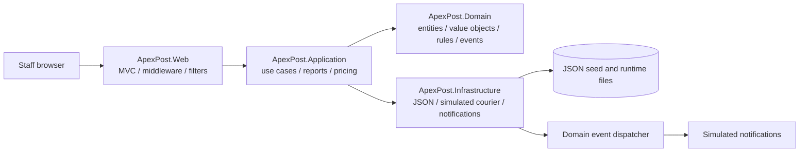
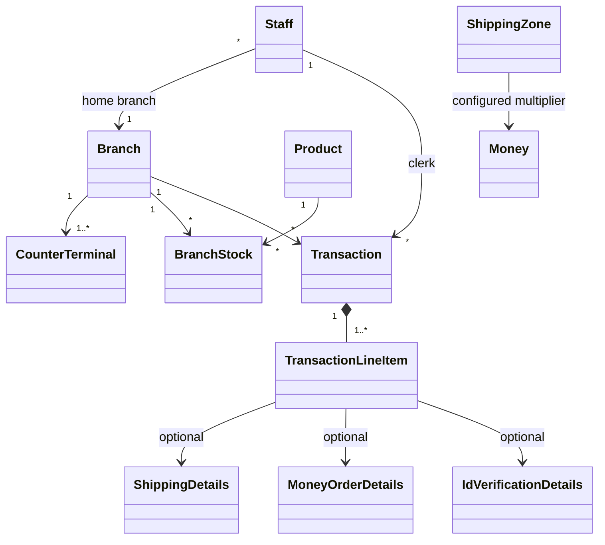

# ApexPost architecture and design decisions

## Architecture

The Week 1 layered architecture survived the domain change; the TechNova entities and behaviors were replaced with ApexPost branch, staff, stock, shipping, money-order, identity-verification, and transaction models. The Web project is a new presentation layer. The repository interfaces remain in Application so JSON persistence can be replaced without moving business rules.

### Domain model

Entities own identity and lifecycle: `Branch`, `Staff`, `Product`, `BranchStock`, `Transaction`, and `ShippingZone`. `Money`, `Weight`, `Dimensions`, `BranchCode`, `Sku`, `Address`, `ShippingDetails`, `MoneyOrderDetails`, and `IdVerificationDetails` are value-oriented data. `TransactionLineItem` uses composition plus a typed discriminator (`LineItemType`) so one basket can mix retail and postal/financial services without an inheritance tree.

The diagram's `CounterTerminal` represents a terminal ID stored on its branch; it is not currently a separate persistence entity.

## Middleware pipeline

The pipeline has 21 always-on middleware registrations, plus production-only HSTS and two endpoint mappings (24 registrations in production, 23 in Development). Order is intentional:

1. `UseForwardedHeaders` accepts only headers from the framework's trusted proxy list. `ForwardedHeaders:KnownProxies` can add explicitly trusted proxy IPs; it must run before HTTPS-aware middleware.
2. `UseHsts` (non-Development) adds browser HTTPS enforcement using the effective scheme after trusted proxy headers are processed.
3. `RequestCorrelationMiddleware` validates/reuses a safe `X-Correlation-Id` or generates one, echoes it, and creates a logging scope.
4. `GlobalExceptionMiddleware` catches downstream failures and returns safe Problem Details with the trace ID; stack traces are never returned.
5. `RequestLoggingMiddleware` logs method/path/status in `finally`.
6. `RequestTimingMiddleware` measures successful and failed requests in `finally`.
7. `SecurityHeadersMiddleware` sets CSP, `X-Content-Type-Options`, `X-Frame-Options`, and `Referrer-Policy` in `OnStarting`.
8. `MaintenanceModeMiddleware` returns 503 and `Retry-After`, except for `/health`.
9. `UseRequestLocalization` sets the supported `en-AU` culture.
10. `UseResponseCompression` compresses eligible responses (not HTTPS responses by default).
11. `UseStatusCodePages` supplies bodies for otherwise-empty HTTP error statuses.
12. `UseCookiePolicy` applies secure, HttpOnly, strict-same-site cookie requirements.
13. `UseHttpsRedirection` runs before static content can be served over HTTP.
14. `UseStaticFiles` serves local CSS/JavaScript assets.
15. `UseRouting` selects endpoint metadata before metadata-aware middleware runs.
16. `UseCors` applies the named tracking-widget origin policy from the parcel-status endpoint metadata.
17. `UseRateLimiter` enforces login and partner fixed-window limits; configured partners receive independent partitions by partner ID, never by storing an API key as the partition label.
18. `ApiKeyAuthenticationMiddleware` protects endpoints marked with `[ApiKeyRequired]`; it requires at least one configured partner key, compares candidate keys in constant time, returns 401 for missing/invalid values, and returns 500 if configuration is absent.
19. `IpRestrictionMiddleware` checks the post-forwarding remote IP against `Security:AllowedIps` for endpoints marked with `[IpRestricted]` (integration and administrator staff routes); it never parses arbitrary `X-Forwarded-For` itself.
20. `UseAuthentication` validates the staff cookie.
21. `UseAuthorization` evaluates role/branch policies.
22. `UseAntiforgery` applies endpoint antiforgery metadata; state-changing MVC actions also explicitly validate tokens.
23. `MapHealthChecks("/health")` and conventional MVC endpoint mapping register the application endpoints.

The default forwarded-header trust list is deliberately not cleared. A deployment behind a proxy must configure its exact proxy addresses; trusting arbitrary forwarding headers permits IP spoofing and can bypass the partner allowlist. CORS only restricts browser JavaScript and does not authenticate non-browser callers; API-key and IP controls remain necessary.

## Middleware versus MVC filters

| Concern | Placement | Reason |
|---|---|---|
| Correlation ID, request logs/timing, exception boundary | Middleware | Must include routing, static files, health checks, MVC, and errors. |
| HSTS, HTTPS, security headers, compression, cookies, CORS | Built-in/custom middleware | Operates on the HTTP transport and response headers. |
| Maintenance, API key, IP restriction, rate limiting | Middleware | Rejects requests before controller work; API-key middleware uses endpoint metadata after routing. |
| Audit trail | `AuditActionFilter` (`IAsyncActionFilter`) | Needs MVC controller/action/route metadata and records the action result, duration, identity, and correlation ID. |
| Model-state consistency | `ValidationActionFilter` on stock adjustment; explicit MVC checks on form controllers | Stock is a request endpoint with a consistent BadRequest response; staff, counter, and shipping forms redisplay with validation errors and repopulated choices. |
| Slow-action warning | `PerformanceActionFilter` | Measures MVC action execution and uses the configurable action threshold. |

Audit and performance filters are globally registered through DI. The validation filter is applied with `ServiceFilter` to stock adjustment, where a BadRequest is the appropriate form-independent response. Staff, counter, and shipping form actions handle invalid model/domain input locally so the submitted form can be redisplayed with its validation errors and required selection data. The audit filter records controller/action and a small allowlist of route/action identifiers (`controller`, `action`, `id`, `transactionId`, `branchCode`, `counterId`); it does not serialize model objects, request bodies, or form values such as document numbers, passwords, or reasons.

## Data, async work, and lifetimes

- `IRepository<T>` provides JSON persistence and locked `UpdateAsync` operations. Stock decrement is performed under the repository's `SemaphoreSlim`, preventing concurrent requests in this app process from taking the same last unit. JSON replacement is written to a same-directory temporary file and then renamed so an interrupted write does not truncate the previous file.
- Checkout persists an open transaction marker, reserves stock atomically, validates/completes the transaction, and then persists it as paid. Failures before the paid save compensate stock reservations and remove the open marker; failures during compensation are surfaced as an aggregate error for reconciliation. This is a single-process JSON workflow, not a cross-process database transaction.
- Stock adjustments are limited to active branch managers, require a signed quantity and a reason code, use the locked stock repository update, and emit low-stock events. The audit filter records SKU, quantity delta, and reason code without free-form reason text.
- Voids and refunds restock retail quantities. Each stock row records reversal transaction IDs under the same per-file update lock, making each row's restock idempotent if reversal processing is retried after a partial failure. The transaction remains marked as pending until all rows are updated; this does not provide multi-file crash atomicity or cross-process transactions.
- `StaffManagementService` owns staff creation, update, duplicate-email validation, branch validation, ID allocation, and deactivation. Its singleton semaphore serializes these workflows within one application process; JSON file locks and this semaphore do not coordinate multiple application instances.
- Transaction status, payment method, and reversal metadata have explicit `JsonInclude` annotations so private setters are restored during JSON deserialization. This is required for historical paid transactions to remain paid in reports and for reversal authorization/state checks to work after reload.
- Identity checks use an explicitly simulated format validator, not an external or government identity provider. The clerk no longer supplies the success result. Only masked last-four details and the result are added to the transaction.
- Reads/writes use asynchronous stream APIs and propagate `CancellationToken`; repository locks and simulated courier concurrency are bounded with `SemaphoreSlim`.
- Dashboard branch/product/transaction/stock reads are independent, so `Task.WhenAll` overlaps them.
- The product catalogue uses `IMemoryCache` with a five-minute TTL, `ValueTask`, and a single-flight semaphore. `ProductCataloguePerformanceTests` issues 10,000 reads against 30 products and deterministically observes one cached backing load versus 10,000 uncached loads. Elapsed time is diagnostic only; this in-memory test is not a disk-throughput benchmark.
- Low-stock events are queued after stock reservation; transaction-completion, high-value money-order, low-stock, and void/refund notifications are dispatched after the relevant transaction state is persisted. These in-process notifications are not a durable outbox.
- Scoped MVC/report/transaction services are resolved per request. JSON repositories, audit store, catalogue cache, courier-rate service, notification service, event dispatcher, and staff-management service are singletons; these contain no scoped dependencies. Middleware constructors receive only singleton-safe configuration/loggers; scoped application services are not captured by middleware.
- JSON repository files are runtime mutable data; the application output `Data` directory must be writable. The audit store is append-only JSON Lines (`audit-log.jsonl`); `AUDIT-SAMPLE.json` is a readable sample.
- Branch opening hours are interpreted in each branch's configured `TimeZoneId`. Seed branches use their Australian region timezone; deployment data must keep that timezone accurate.
- The simulated courier tracking lookup applies a linked timeout token. Its timeout is distinct from caller cancellation; this exercises the cancellation contract without claiming a real courier integration.

## Advanced C# 14 usage

| Feature | Where it solves a real problem |
|---|---|
| Records and value objects | Shipping/order details, line items, audit rows, money/weight/SKU/branch codes prevent primitive-only domain APIs. |
| Pattern matching | Shipping service/parcel pricing, tax categories, event dispatch, and role-sensitive behavior. |
| C# 14 extension members and `field` | `Money.RoundedToCurrencyPrecision` is an extension property; the `Money.Amount` backing field validates and rounds on assignment. |
| Generic constraints and repository abstraction | `IRepository<T> where T : class` centralizes asynchronous JSON persistence behind an application contract. |
| `Predicate<T>` | The low-stock report accepts an optional predicate while keeping the branch filter enforced separately. |
| `Func<ShippingDetails, decimal, Money>` | The tiered pricing strategy accepts an injectable pricing rule; the configured default keeps zone multipliers and parcel weight surcharge explicit while tests can substitute a business rule. |
| Custom attribute and cached reflection validator | `[NotBlank]` validates transaction line-item descriptions; `DomainAttributeValidator` caches the annotated property metadata per type. |
| Domain events | Transaction completion, money-order issue, stock-low, and void/refund events are dispatched to notification handlers after persistence. |
| Async/await and cancellation | MVC, application, repository, audit, cache, and rate lookups pass cancellation through asynchronous I/O. |
| `Task.WhenAll` | Independent dashboard reads are awaited together. |
| `SemaphoreSlim` | Bounds JSON writes/updates, audit appends, catalogue cache fills, and simulated courier quote concurrency. |
| `ValueTask` and cache | Hot catalogue reads return synchronously from memory; cache fills remain asynchronous and coalesced. |
| Cancellation versus timeout | Simulated courier tracking uses a linked timeout token and returns a distinct timeout failure; caller cancellation remains cancellation and is not reported as a timeout. |

There is intentionally no `Thread.Sleep`, `.Wait()`, or `.Result` in the solution.

The tracking timeout and simulated latency are configured with `CourierTracking:TimeoutMs` and `CourierTracking:SimulatedDelayMs`. A timeout returns HTTP 504 at the partner endpoint; a caller cancellation is not transformed into a successful or timeout response. The default parcel surcharge is configured with `ShippingPricing:ParcelWeightSurchargePerKilogram`; the pricing strategy validates that it is non-negative at startup.

## Reports

1. Daily paid branch sales split into retail and service totals (including tax), using each branch's local calendar day.
2. Low stock by branch/SKU (threshold 5).
3. Shipping volume by zone and service level.
4. Money-order and verification counts by branch, available through the auditor-only report.

## ADRs

### ADR-01: Keep the layered architecture, replace the domain

The domain changed from TechNova RMS to postal retail, but Domain/Application/Infrastructure boundaries remain useful. TechNova-specific entities were removed; the MVC web layer was added. This keeps next week's database/API work replaceable without moving domain rules.

### ADR-02: Compose mixed baskets with typed line items

`TransactionLineItem` composes optional shipping, money order, or identity details and a `LineItemType`; it avoids an inheritance hierarchy for a basket that can mix goods and services. Domain completion validates the same-transaction verification rule.

### ADR-03: Represent core measures as value objects

Money, weight, SKU, and branch identifiers have domain types. This avoids ambiguous decimal/string values and gives validation one authoritative home.

### ADR-04: Use a pricing strategy plus JSON-backed zone rates

The strategy owns parcel/letter, service-level, weight, and tax rules. Ten configured zone multipliers live behind the JSON repository. Unknown zones and unsupported service levels fail explicitly instead of receiving a fallback price.

### ADR-05: Keep JSON behind repositories during Week 2

There is no ORM/database. Repositories provide async contracts and atomic per-file stock updates; an SQL implementation can later replace Infrastructure without changing transaction rules.

### ADR-06: Use custom cookie authentication, not ASP.NET Core Identity

The assignment requires cookie authentication with `StaffId`, `Role`, and `BranchCode` claims. Role policies and branch claims are used by protected counter, staff, and audit operations. Demo credentials are local user-secrets, not source-controlled configuration.

### ADR-07: Separate transport middleware from MVC filters

Transport-wide security, routing, errors, and telemetry use middleware. Audit, model validation, and slow-action measurement use filters because they need MVC action metadata and model state.

### ADR-08: Append audit records and minimize personal data

Audit rows are serialized as append-only JSON Lines behind `IAuditStore`. They include actor, role, branch, controller/action, safe route keys, result status, duration, time, and correlation ID. Request bodies, document numbers, credentials, API keys, and card data are excluded.

### ADR-09: Bound concurrency and cache hot reads

Per-file and simulated courier access is limited with semaphores; dashboard reads overlap; the product catalogue is cached with a short TTL. These choices bound contention and repeated disk reads without introducing an external cache or package.

### ADR-10: Compensate JSON checkout reservations

JSON files cannot provide a transaction across inventory and sales records. Checkout writes an open transaction marker, applies each stock reservation under the repository lock, and marks the sale paid only after domain validation. On a failure before the paid save, it restores reservations and deletes the open marker; any rollback failure is raised for manual reconciliation. Atomic file replacement protects each individual JSON file, but the workflow remains single-process and does not claim database-grade crash atomicity.

### ADR-11: Verify document format through a replaceable simulation

The clerk supplies the document data, but cannot set the verification result. The infrastructure simulation validates document type and format, returns a result, and creates only a masked value for transaction persistence. It is explicitly not represented as a real identity provider; a later integration can replace the interface implementation.

### ADR-12: Restock voided and refunded retail goods idempotently

Successful voids and refunds return the sold retail quantities to branch stock. Each inventory row records transaction IDs already restocked while holding that row's JSON update lock. A partially processed reversal can resume without double-counting rows already completed. Because multiple files are involved, process crashes can still require reconciliation; a durable database transaction/outbox is a later-week concern.

### ADR-13: Process trusted proxy metadata before HSTS

Forwarded headers are applied before HSTS and HTTPS redirection so TLS-terminating deployments use the effective client scheme. The framework proxy trust list remains restrictive; production must configure the exact proxy addresses and allowed clients.

### ADR-14: Keep staff rules in the application service and serialize local writes

Staff uniqueness, branch validation, ID allocation, update, and deactivation belong to `StaffManagementService`, not the MVC controller. A singleton semaphore prevents overlapping staff workflows from allocating the same ID within one process. This is explicitly not a distributed lock; deployment with multiple writers requires a database uniqueness constraint/transaction in a later persistence phase.

### ADR-15: Make pricing rules replaceable and JSON state round-trip safe

`TieredShippingPricingStrategy` accepts a `Func<ShippingDetails, decimal, Money>` rule and the standard parcel surcharge is configuration-backed. Transaction state with private setters is explicitly included during JSON deserialization so paid/refunded/voided state is not silently reset to the default open state. Unit and integration tests cover configurable pricing and a persisted paid sale.

## SOLID mapping

- **Single Responsibility:** Domain rules, orchestration, JSON I/O, MVC transport, and audit each live in their own layer/service.
- **Open/Closed:** `IPricingStrategy`, repository interfaces, event dispatcher, and notification interface permit alternate pricing, storage, or notification implementations.
- **Liskov Substitution:** JSON repositories implement the same `IRepository<T>` async contract and can be substituted with database repositories.
- **Interface Segregation:** Catalogue, audit, courier-rate, notification, and repository consumers depend on focused interfaces.
- **Dependency Inversion:** Application use cases depend on repository/rate/event contracts; Web composes Infrastructure implementations in `Program.cs`.

## Security and audit threats / mitigations

| Threat | Mitigation |
|---|---|
| Password/API-key disclosure | No real secrets in appsettings/source; use user-secrets or deployment secret stores. |
| Brute-force login / partner overload | Per-IP login fixed window (3/minute); authenticated partner partition limit (60/minute); 429 and `Retry-After`. |
| Forged state-changing form requests | Antiforgery token validation for every MVC POST; strict, Secure, HttpOnly auth cookies. |
| Unauthorized counter/financial actions | Staff role/branch claims, manager/auditor/admin policies, domain-side active staff and branch checks. |
| Stock race or negative balance | Locked atomic repository update and domain guard. |
| ID-document disclosure | Only masked last-four data is persisted on verification details; request payloads are not audited/logged. |
| API-key timing/transport abuse | Fixed-time comparison, header-only credential, HTTPS, configured key requirement, partner IP allowlist, rate limiting. |
| Forwarded-IP spoofing | Forwarded headers processed only from trusted proxies; do not trust arbitrary `X-Forwarded-For`; maintain exact known-proxy and allowed-client lists. |
| Browser cross-origin misuse / clickjacking / MIME sniffing | Single approved CORS origin, CSP, frame denial, `nosniff`, Referrer-Policy. CORS is explicitly not treated as API authentication. |
| Error detail leakage / untraceable failures | Safe Problem Details with correlation trace ID; exception details stay in server logs. |
| Audit tampering and excess PII | Append-only JSONL writes behind `IAuditStore`; no sensitive form data in entries; operational file access remains a deployment responsibility. |

## Validation

`ApexPost.Test` contains domain-rule and transaction-workflow tests for stock, identity verification, parcel weight, configurable pricing, currency consistency, branch hours, JSON transaction-state round trips, checkout compensation, multi-line sales, branch-manager stock adjustments, and idempotent void/refund restocking. Staff-service tests cover normalization, duplicate emails, branch/role validation, inactive-status preservation, and simultaneous create attempts. Middleware tests cover missing API-key configuration, invalid keys, maintenance mode, trusted forwarded HTTPS/HSTS ordering, and cancellation-versus-timeout behavior. WebApplicationFactory tests cover security headers, API-key/CORS/IP behavior, login and partner rate limits, authentication redirects, clerk void denial and audit redaction, correlation ID reuse, branch-scoped reports, authorized auditor/administrator pages, validation-error form redisplay, stock-adjustment audit data, failed-checkout stock restoration, and a successful paid sale in the audit trail. Run `dotnet build ApexPost.slnx -warnaserror` and `dotnet test ApexPost.Test/ApexPost.Test.csproj`.
