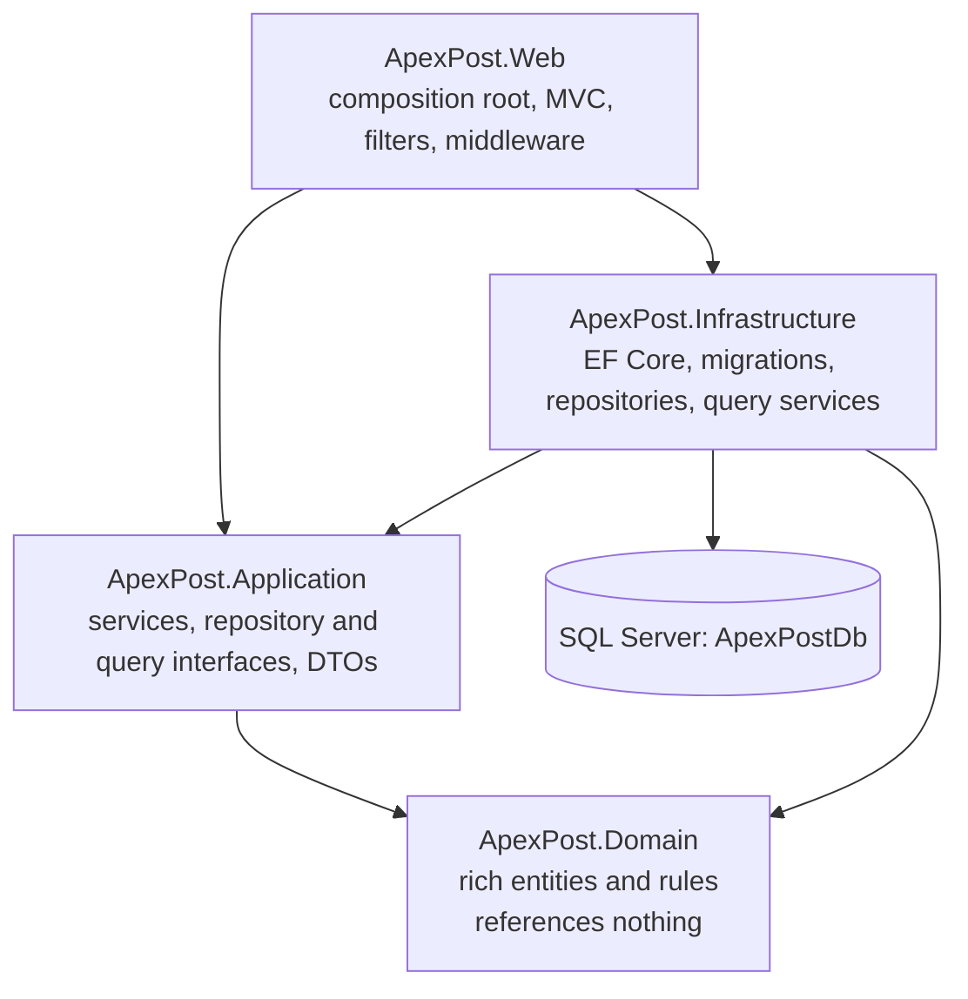
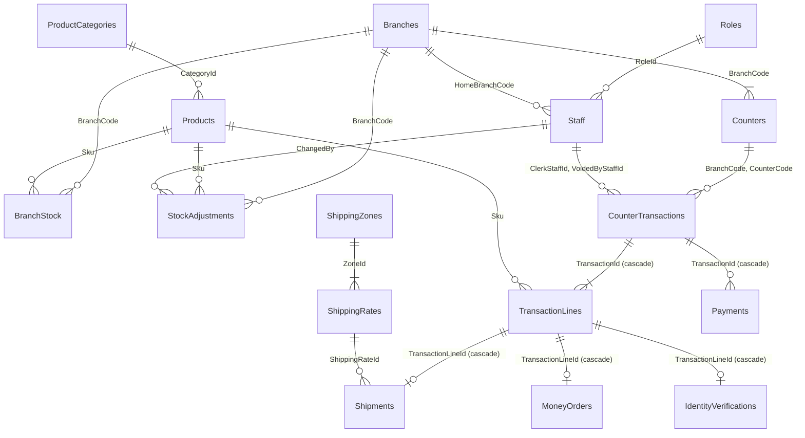
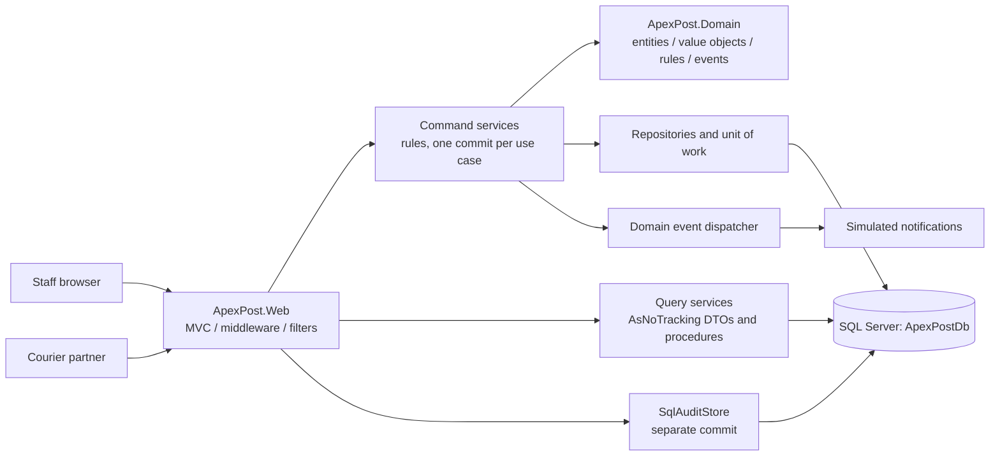
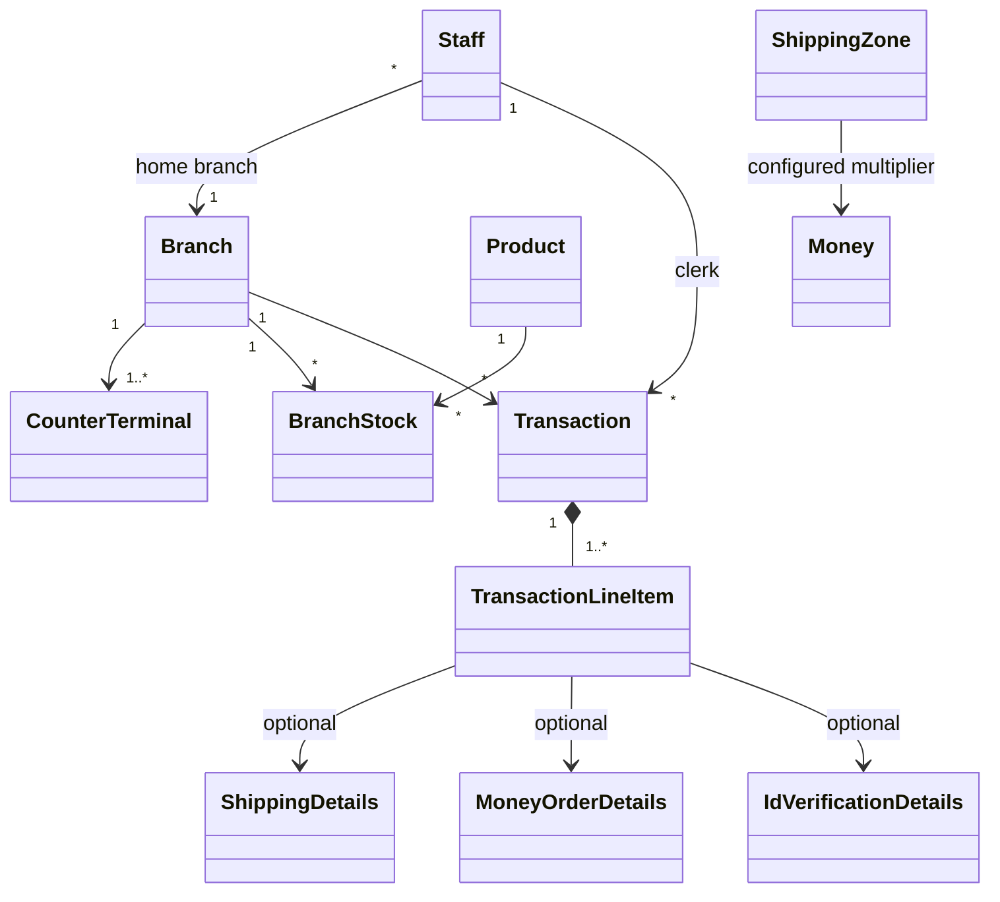

# ApexPost architecture and design decisions

## Week 3: SQL Server and EF Core

SQL Server, reached through EF Core 10, is now the system of record, behind interfaces in the Application layer. ADRs that Week 3 replaced say so at the top.

**Evidence status:** this has run on SQL Server 2022 Developer in a local Docker container. All migrations applied, the idempotent script ran twice cleanly, all 175 tests pass against the real server, the app ran under the least-privilege login, and `PERFORMANCE.md` holds measured results. It also had a five-minute load test and a forced deadlock.

### Layers and dependencies

Commands go through services, repositories and the unit of work. Reads go through `IDashboardQueries`, `IReportQueries` and `IScreenQueries`, which use `AsNoTracking` projections or stored procedures and return DTOs. Both sides use the same database; no separate read store exists. The DbContext, repositories, unit of work and services are all scoped, so they share one DbContext per request.

### ER diagram

`AuditEntries` has no foreign keys on purpose: an audit row must outlive whatever it describes, and it also records anonymous and denied attempts.

`Dimensions` and the optional destination `Address` on `Shipments` are owned types, stored as columns on that table. Keys and constraints are defined in `EntityConfigurations.cs` and are visible in `sql/schema/ApexPostDb-idempotent.sql`. Every table has `CreatedAtUtc`, `CreatedBy` and `ModifiedAtUtc` as shadow properties, and `BranchStock` and `CounterTransactions` have a `RowVersion`.

| Rule | Where it is enforced |
|---|---|
| Unique `BranchCode`, `Sku`, staff email | `UQ_Branches_BranchCode`, `UQ_Products_Sku`, `UQ_Staff_Email` |
| Quantities not negative, amounts positive | `CK_BranchStock_Quantity`, `CK_TransactionLines_Quantity`, `CK_MoneyOrders_Amount`, `CK_Products_UnitPrice` |
| Allowed status and type values | `CK_CounterTransactions_Status`, `CK_TransactionLines_Type`, `CK_Payments_Kind` |
| Weight limits | `CK_Shipments_Weight`, `CK_ShippingRates_MaxWeight` |
| Masked documents only | `varchar(10)` and `CK_IdentityVerifications_Masked` |
| Counter belongs to the branch | Composite foreign key from `CounterTransactions` to `Counters` |

### Normalization: three anomalies this design prevents

1. **Update anomaly:** zone and service level live once, on `ShippingRates`. If `Shipments` repeated them, one correction could leave old shipments saying something different.
2. **Insertion anomaly:** branches and products exist in their own tables, so a new product with no sales yet can still be stored, and a new branch needs no staff or stock first.
3. **Deletion anomaly:** `Products` is separate from `TransactionLines`, and the foreign key is `Restrict`, so removing a product can never silently erase what it sold. Lines also keep their own description, price and tax, so history stays correct after a price change.

`LineTotal`, `TaxAmount` and `BusinessDate` look derived but are facts frozen at sale time. They must not change when a tax rate or a branch time zone changes later.

### Delete behaviour

| Relationship | Behaviour | Why |
|---|---|---|
| Transaction to lines and payments; line to shipment, money order, identity check | Cascade | These rows have no meaning without their parent. |
| Everything referencing branches, staff, products, zones and rates | Restrict | History must not vanish. Deactivate branches and staff instead. |

### Stored procedures and least privilege

`usp_DailyBranchSales`, `usp_LowStockReport` and `usp_AdjustStock` are in `sql/procedures` and deployed by the `AddStoredProcedures` migration. EF Core calls them only through parameterized `SqlQuery`. Tested with a restricted login and the test `LeastPrivilegeRole_CanRunTheAppButCannotDeleteOrChangeSchema`, the application login needs the `apexpost_app` role from `sql/security/least_privilege_role.sql`: `SELECT`, `INSERT` and `UPDATE` on `dbo`, `EXECUTE` on the three procedures, no `DELETE`, and no schema changes. It can only add to `AuditEntries`. Migrations run under a separate deployment login.

### Deviations to review

- **Index style:** `[Index]` can't express `INCLUDE` or filters and can't be placed on Domain classes, so some indexes combine it with Fluent, and `BranchStock` uses Fluent alone (ADR-26).
- **Security pin:** `System.Security.Cryptography.Pkcs` isn't on the allowed list. It's pinned to fix a vulnerable version that SqlClient brings in. **This needs trainer approval** (ADR-32).
- **Test doubles:** MVC tests that run without a database use in-memory fakes, which is not a second database. The assignment's WebApplicationFactory tests against a test database also exist, and run when `APEXPOST_TEST_SQLSERVER` is set.
- **Blocking demo tool:** the demo ran in `sqlcmd` sessions on a Mac, where SSMS isn't available. README has the steps to repeat it in SSMS.
- **Seed loading:** seed files in `ApexPost.Infrastructure/Data` are JSON, read once by `DatabaseSeeder`. They aren't a persistence store.
- **Not implemented:** the offline synchronization topics in the lab list aren't in this assignment's requirements.

## Architecture

The Week 1 layered architecture survived the domain change, and Week 3's move to SQL Server changed only Infrastructure and the composition root. The layer diagram is at the top of this document, and runtime flow looks like this:

### Domain model

Entities own identity and lifecycle: `Branch`, `Staff`, `Product`, `BranchStock`, `Transaction`, and `ShippingZone`. `Money`, `Weight`, `Dimensions`, `BranchCode`, `Sku`, `Address`, `ShippingDetails`, `MoneyOrderDetails`, and `IdVerificationDetails` are value-oriented data. `TransactionLineItem` uses composition plus a typed discriminator (`LineItemType`) so one basket can mix retail and postal/financial services without an inheritance tree.

The diagram's `CounterTerminal` represents a terminal ID stored on its branch; it is not currently a separate persistence entity.

## Middleware pipeline

The pipeline order is deliberate:

1. `UseForwardedHeaders` accepts only headers from the framework's trusted proxy list. `ForwardedHeaders:KnownProxies` can add explicitly trusted proxy IPs; it must run before anything that reads the client IP or scheme.
2. `UseHsts` (non-Development) adds browser HTTPS enforcement using the effective scheme.
3. `RequestCorrelationMiddleware` validates or generates `X-Correlation-Id`, opens a logging scope, and sets the response header in `OnStarting` so it survives the exception handler's `Response.Clear()`. It is first so every later log line carries the ID (`Logging:Console:IncludeScopes` is on).
4. `RequestLoggingMiddleware` logs method, path and final status in `finally`. It sits **outside** the exception boundary, so a failed request is logged as 500 rather than the default 200.
5. `RequestTimingMiddleware` measures every request in `finally`, also outside the exception boundary, and warns above `Performance:SlowRequestThresholdMs`.
6. `GlobalExceptionMiddleware` turns any failure below it into safe Problem Details with the trace ID. A client-cancelled request is logged as cancellation and recorded as 499, never as a failure.
7. `SecurityHeadersMiddleware` sets CSP, `X-Content-Type-Options`, `X-Frame-Options` and `Referrer-Policy` in `OnStarting`, so error responses get them too.
8. `MaintenanceModeMiddleware` returns 503 and `Retry-After`, except for `/health`.
9. `UseRequestLocalization` sets the supported `en-AU` culture.
10. `UseResponseCompression` compresses eligible responses (not HTTPS responses by default).
11. `UseStatusCodePages` supplies bodies for otherwise-empty HTTP error statuses.
12. `UseCookiePolicy` applies secure, HttpOnly, strict-same-site cookie requirements.
13. `UseHttpsRedirection` runs before static content can be served over HTTP.
14. `UseStaticFiles` serves local CSS/JavaScript without authentication or MVC work.
15. `UseRouting` selects the endpoint so metadata-aware middleware can read its attributes.
16. `UseCors` applies the named widget policy from endpoint metadata, and answers preflight before any credential check.
17. `IpRestrictionMiddleware` checks the post-forwarding client IP against `Security:AllowedIps` for `[IpRestricted]` endpoints. It runs before rate limiting and key checks: a blocked address always gets 403, learns nothing about key validity, and costs no quota.
18. `UseRateLimiter` enforces the login and per-partner fixed windows; partners get independent partitions by partner ID, never by key value.
19. `ApiKeyAuthenticationMiddleware` protects `[ApiKeyRequired]` endpoints. Keys are SHA-256 hashed and compared in constant time, returning 401 for missing or invalid keys and 500 if none is configured.
20. `UseAuthentication` validates the staff cookie.
21. `UseAuthorization` evaluates role and branch policies. `AuditingAuthorizationResultHandler` audits denied business actions, and a forbidden signed-in user receives 403 rather than a login redirect.
22. `UseAntiforgery` applies endpoint antiforgery metadata; MVC also validates every unsafe request through the global `AutoValidateAntiforgeryToken` filter.
23. `MapHealthChecks("/health")` and the conventional `{controller=Home}/{action=Index}/{id?}` route register the endpoints.

The default forwarded-header trust list is deliberately not cleared. A deployment behind a proxy must configure its exact proxy addresses; trusting arbitrary forwarding headers permits IP spoofing and can bypass the partner allowlist. CORS only restricts browser JavaScript and does not authenticate non-browser callers; API-key and IP controls remain necessary.

## Middleware versus MVC filters

| Concern | Placement | Reason |
|---|---|---|
| Correlation ID, request logs/timing, exception boundary | Middleware | Must include routing, static files, health checks, MVC, and errors. |
| HSTS, HTTPS, security headers, compression, cookies, CORS | Built-in/custom middleware | Operates on the HTTP transport and response headers. |
| Maintenance, API key, IP restriction, rate limiting | Middleware | Rejects requests before controller work; API-key middleware uses endpoint metadata after routing. |
| Audit trail | `AuditActionFilter` (`IAsyncActionFilter`), only for actions marked `[AuditedAction]` | Needs MVC action metadata, arguments and the action result. Limiting it to business actions keeps the log meaningful. |
| Denied business actions | `AuditingAuthorizationResultHandler` | Authorization rejects before MVC filters run, so a filter cannot see these attempts. |
| Model-state consistency | Global `ValidationActionFilter` | Needs model state, action arguments and the controller to redisplay a view, none of which exist in middleware. |
| Slow-action warning | `PerformanceActionFilter` | Measures MVC action execution and uses the configurable action threshold. |

Audit and performance filters are globally registered through DI. The audit filter acts only on actions marked `[AuditedAction("...")]`: sales (including money orders and identity checks), voids, refunds, stock adjustments, and staff, branch and product changes. GET pages and anonymous pages are not audited. Each entry holds the business action, a small allowlist of safe arguments, and non-sensitive details the controller adds explicitly (transaction ID, counter, line count, money order amount, whether an identity check ran, payment method). It never serialises models, request bodies, reasons, sender or recipient names, document numbers or passwords. A failed audit write is logged as an error and never changes the outcome of the completed business action.

`ValidationActionFilter` is global, so no controller repeats a model-state check. An action marked `[RedisplayOnInvalid]` redisplays its view, and a controller implementing `IRepopulatesForm` reloads the form's choices first. Any other action, such as stock adjustment, gets a consistent Problem Details BadRequest.

## Data, async work, and lifetimes

- **Persistence:** all data is in SQL Server. Seed files in `ApexPost.Infrastructure/Data` are read once by `DatabaseSeeder` on an empty database, in one explicit transaction, and are not a store. The schema is only ever created by migrations.
- **Sales:** one `SaveChangesAsync` commits the stock decrement, transaction, lines and payment. `CheckoutAsync` re-runs on a `rowversion` conflict, up to 5 attempts with a short random delay, on fresh data, and the last conflict returns a 409.
- **Voids and refunds:** the status change, payment row and restock commit together.
- **Stock adjustments:** these run through `usp_AdjustStock`, which writes `StockAdjustments` history in the same transaction. Only active branch managers may adjust stock, and each change needs an enumerated reason.
- **Price revisions:** `ExecuteUpdateAsync` updates a whole category in one statement, then the catalogue cache is cleared.
- **Reads:** screens and reports use `AsNoTracking` projections or procedures that return DTOs. A DbContext can't run overlapping operations, so reads in one request run in sequence.
- **Lifetimes:** the DbContext, repositories, unit of work, query services and command services are scoped, so they share one DbContext per request. Middleware receives only singletons, such as options monitors and `PartnerApiKeyValidator`, so it never captures a scoped service. `SqlAuditStore` is a singleton that opens its own scope for each write.
- **Shared state across requests:** the memory cache, its fill gates and `CourierRateGate` outlive a request; the services using them stay scoped.
- **Caching:** the product catalogue and zone rates use `IMemoryCache` with a five-minute lifetime and `ValueTask`, and a single-flight gate. `ProductCataloguePerformanceTests` shows 10,000 reads cause one load, and `CourierRatePerformanceTests` shows 200 parallel zone lookups cause one.
- **Courier calls:** `CourierRateGate` allows `CourierRates:MaxConcurrentRequests` calls around the simulated delay, and a test confirms the limit holds.
- **Business dates:** `BusinessDate` is fixed at sale time from the branch's time zone, so date reports are SARGable (ADR-33).
- **Identity checks:** a simulated format validator decides the result, and clerks can't set it. Only the masked last four characters are stored.
- **Notifications:** alerts are held in memory per branch and dispatched after the commit, so they aren't a durable outbox.
- **Courier tracking:** a linked timeout token keeps a timeout separate from caller cancellation.
- **Configuration:** settings bind to validated `IOptions` classes, and a bad value stops startup. `IOptionsMonitor` lets maintenance mode and the allowlist change without a restart.

## Advanced C# 14 usage

| Feature | Where it solves a real problem |
|---|---|
| Records and value objects | Shipping/order details, line items, audit rows, money/weight/SKU/branch codes prevent primitive-only domain APIs. |
| Pattern matching | Shipping service/parcel pricing, tax categories, event dispatch, and role-sensitive behavior. |
| C# 14 extension members and `field` | `extension(Transaction)` gives `RetailTotal` and `ServicesTotal`, which the daily sales report uses; `extension(Money)` gives a rounding helper; the `Money.Amount` backing field validates and rounds on assignment. |
| Generic constraints | `AddValidatedOptions<TOptions> where TOptions : class` registers every settings class in one place. Week 3 deliberately replaced the generic repository with specific ones (ADR-28). |
| `Func<T, bool>` | `TransactionExtensions.TotalFor` takes a selector, and `LowStockRule` holds the configurable threshold. |
| `Func<ShippingDetails, decimal, Money>` | The tiered pricing strategy accepts an injectable pricing rule; the configured default keeps zone multipliers and parcel weight surcharge explicit while tests can substitute a business rule. |
| Custom attribute and cached reflection validator | `[NotBlank]` validates transaction line-item descriptions; `DomainAttributeValidator` caches the annotated property metadata per type. |
| Domain events | Transaction completion, money-order issue, stock-low, and void/refund events are dispatched to notification handlers after persistence. |
| Async/await and cancellation | MVC, services, repositories, query services and EF Core calls pass `CancellationToken` through. |
| `Task.WhenAll` | In-memory notification lookups on the dashboard overlap. Database reads run in sequence, because a DbContext can't overlap operations (ADR-28). |
| `SemaphoreSlim` | Limits concurrent courier calls, and stops several requests filling the same cache at once. |
| `ValueTask` and cache | Hot catalogue and zone-rate reads return synchronously from memory; cache fills remain asynchronous and coalesced. |
| Cancellation versus timeout | Simulated courier tracking uses a linked timeout token and returns a distinct timeout failure; caller cancellation remains cancellation and is not reported as a timeout. |

There is intentionally no `Thread.Sleep`, `.Wait()`, or `.Result` in the solution.

The tracking timeout and simulated latency are configured with `CourierTracking:TimeoutMs` and `CourierTracking:SimulatedDelayMs`. A timeout returns HTTP 504 at the partner endpoint; a caller cancellation is not transformed into a successful or timeout response. The default parcel surcharge is configured with `ShippingPricing:ParcelWeightSurchargePerKilogram`; the pricing strategy validates that it is non-negative at startup.

## Reports

1. Daily paid branch sales split into retail and service totals (including tax), using each branch's local calendar day.
2. Low stock by branch/SKU (threshold 5).
3. Shipping volume by zone and service level.
4. Money-order and verification counts by branch, available through the auditor-only report.

## ADRs

Each decision records its context, the decision, the alternatives considered and the consequences.

### ADR-01: Keep the layered architecture, replace the domain

**Context:** The domain moved from TechNova resource management to postal retail, and every later week builds on this solution.

**Decision:** Keep the Domain, Application, Infrastructure and Web layers. Replace the TechNova entities and add MVC as the new presentation layer.

**Alternatives:** Rewrite as vertical slices (little benefit at this size); keep one project (business rules would leak into MVC).

**Consequences:** Dependencies still point inward, so the database and API work can replace outer layers. The cost is more mapping between layers.

### ADR-02: Compose mixed baskets with typed line items

**Context:** One basket must hold retail goods, shipping, money orders and identity checks.

**Decision:** `TransactionLineItem` is one record with a `LineItemType` and optional detail records, validated by a switch in `AddLineItem`. `LineItems` is read-only, so `AddLineItem` is the only way in.

**Alternatives:** An inheritance tree (more types and awkward mapping for little behaviour); separate lists per kind (awkward totals and ordering).

**Consequences:** Totals and reports treat every line alike. Optional fields can disagree with the type, which `AddLineItem` guards against.

### ADR-03: Represent core measures as value objects

**Context:** Plain decimals and strings make it easy to mix up amounts, weights and codes.

**Decision:** Use `Money`, `Weight`, `Dimensions`, `Sku`, `BranchCode` and `Address` as records, with validation in one place.

**Alternatives:** Primitives with validation in services (rules get duplicated and skipped).

**Consequences:** Signatures document themselves and mixed currencies throw. Forms and persistence need small conversions.

### ADR-04: Use a pricing strategy plus database-backed zone rates

**Context:** Prices depend on parcel or letter, service level, weight and zone, and the rules will change. Weight limits differ too.

**Decision:** `IPricingStrategy` holds base rates and limits using tuple pattern matching, with an injectable `Func` for the price rule and zone multipliers from the database. Parcels have service-level limits and need dimensions; letters have a 0.5 kg limit and need none. Tax categories are applied by `Money.CalculateTax`.

**Alternatives:** Rates in `if` chains inside the service (hard to test); a full rules engine (too heavy for six base rates).

**Consequences:** Rules can be tested and replaced alone. Unknown zones fail rather than getting a fallback price. Tax rates remain in code until a later week needs them configurable.

### ADR-05: Keep JSON behind repositories during Week 2

**Status: Replaced in Week 3 by ADR-25 and ADR-28.**

**Context:** No database is allowed this week, but next week's database must not disturb business logic.

**Decision:** Keep async JSON repositories behind `IRepository<TEntity, TId>`, registered only through `AddJsonPersistence`.

**Alternatives:** Direct file access from services (blocks the swap); an in-memory store (loses persistence).

**Consequences:** The database change stays in Infrastructure. Whole-file reads and writes are slow at scale and only safe in one process.

### ADR-06: Use custom cookie authentication with per-staff password hashes

**Context:** The assignment forbids ASP.NET Core Identity and secrets in source. The first version had one shared password committed in `appsettings.json`.

**Decision:** Each `Staff` record stores a salted PBKDF2-SHA256 hash (600,000 iterations) from `IPasswordHasher`, using only the base class library. `StaffAuthenticationService` verifies it, doing the same work for unknown emails. Cookies carry `StaffId`, `Role` and `BranchCode`.

**Alternatives:** ASP.NET Core Identity (not allowed); a shared password from user-secrets (no individual accountability); fast hashes such as SHA-256 alone (easy to brute force).

**Consequences:** Logins are accountable to one person and no usable password is stored. Seed hashes belong to documented demo accounts that must never reach production. The old shared password stays in Git history but no longer works anywhere.

### ADR-07: Separate transport middleware from MVC filters

**Context:** Each cross-cutting concern could sit in either place.

**Decision:** Anything needed for every request, or before routing to MVC, is middleware. Anything needing action metadata, arguments, model state or results is a filter.

**Alternatives:** All middleware (no model state or action result); all filters (would miss static files, health checks and pre-MVC failures).

**Consequences:** Each concern has one obvious home. Authorization denials happen before filters, which ADR-20 handles.

### ADR-08: Append audit records and minimise personal data

**Status: Storage replaced in Week 3 by ADR-31. The audit trail now lives in `AuditEntries`; the data-minimising rules still apply.**

**Context:** Business actions must be traceable to a person, branch, time and correlation ID without storing sensitive data.

**Decision:** Write append-only JSON Lines behind `IAuditStore`, using allowlisted values only.

**Alternatives:** Serialising whole request models (leaks personal data sooner or later); only application logs (not a dedicated, queryable trail).

**Consequences:** Appends are cheap and history is not rewritten. File permissions remain a deployment responsibility, and a database store can replace it next week.

### ADR-09: Bound concurrency and cache hot reads

**Status: Partly replaced in Week 3. File locks are gone and database reads no longer overlap (ADR-28); caching and courier limits still apply.**

**Context:** Unbounded file and courier access would cause contention, and the catalogue is read constantly.

**Decision:** Use `SemaphoreSlim` per file and for courier rates, `Task.WhenAll` for independent reads, and `ValueTask` with `IMemoryCache` for the catalogue, invalidated when a product changes. A test shows 10,000 reads cause one load.

**Alternatives:** A global lock (slows unrelated data); an external cache (not allowed and unnecessary).

**Consequences:** Concurrent sales were confirmed safe under load. Locks only work within one process.

### ADR-10: Compensate JSON checkout reservations

**Status: Replaced in Week 3 by ADR-30. One database transaction makes compensation unnecessary.**

**Context:** JSON files cannot offer a transaction across stock and sales.

**Decision:** Save an open marker, reserve stock under the repository lock, and mark paid last. On failure, restore reservations and delete the marker; surface a rollback failure for reconciliation.

**Alternatives:** Validate then write without compensation (partial failures lose stock); a hand-written transaction log (too complex for one week).

**Consequences:** Normal failures leave stock correct. A process crash can still need reconciliation until a database transaction replaces this.

### ADR-11: Verify document format through a replaceable simulation

**Context:** No real identity provider exists, and clerks must not be able to mark a check as passed themselves.

**Decision:** `IIdentityVerificationService` decides the result. Only a masked last-four value is kept, and numbers of four characters or fewer are refused because masking could not hide them.

**Alternatives:** A clerk tick box (bypasses the rule); keeping encrypted numbers (risk with no benefit).

**Consequences:** A provider can be plugged in later. The current check validates format only and is labelled as simulated in the UI.

### ADR-12: Restock voided and refunded goods idempotently

**Status: Replaced in Week 3 by ADR-30. The status change and restock now commit together.**

**Context:** Reversals touch several files and may be retried after a partial failure. A concurrent void and refund must not both succeed.

**Decision:** The status change runs inside the repository's locked update. Each stock row records reversal IDs it has restocked, and the transaction is flagged only when all rows are done.

**Alternatives:** Restock without markers (retries double count); no restocking (stock drifts from reality).

**Consequences:** Retries are safe and one reversal wins. Stock rows hold small extra history, which a database can move to a table.

### ADR-13: Process trusted proxy metadata before HSTS

**Context:** Behind a TLS proxy the app must know the real scheme and client IP, yet forwarded headers can be spoofed.

**Decision:** Run forwarded headers first and accept them only from configured proxies, with a limit of one hop.

**Alternatives:** Parse `X-Forwarded-For` in the IP middleware (spoofable); trust all proxies (bypasses the allowlist).

**Consequences:** Allowlist decisions are reliable, but each deployment must configure its exact proxy addresses.

### ADR-14: Keep management rules in services and serialise local writes

**Status: Updated in Week 3. Services are scoped, and the semaphores were replaced by database unique constraints.**

**Context:** Staff, branch and product changes have uniqueness, reference and ID rules. Without management screens, branches and products could not be changed at all.

**Decision:** `StaffManagementService`, `BranchManagementService` and `ProductManagementService` own these rules behind singleton semaphores, with thin administrator-only controllers. New branches and products get zero-quantity stock rows.

**Alternatives:** Rules in controllers (violates the brief); relying only on the per-file lock (does not cover check-then-write across files).

**Consequences:** Rules are testable and controllers stay thin. The semaphores are not distributed locks; database constraints replace them later.

### ADR-15: Make pricing rules replaceable and JSON state round-trip safe

**Status: Updated in Week 3. `[JsonInclude]` now serves only seed loading; columns hold state in SQL Server.**

**Context:** Private setters protect entities, but JSON would silently reset them to defaults on load.

**Decision:** Mark state with `[JsonInclude]`, keep `Func` pricing rules injectable, and bind the parcel surcharge from configuration.

**Alternatives:** Public setters (rules can be bypassed); separate storage models (a lot of mapping for one week).

**Consequences:** Paid transactions stay paid after reload, with tests proving it. Entities carry a serialisation attribute until the database mapping arrives.

### ADR-16: Type repository keys and add specifications

**Status: Replaced in Week 3 by ADR-28, which keeps its aim of compile-time safety.**

**Context:** `IRepository<T>` took `object id` and used reflection on each call, so wrong ID types failed silently at runtime.

**Decision:** Use `IRepository<TEntity, TId>` constrained to `Entity<TId>`, plus `ISpecification<T>` and a `FindAsync` extension for report filters.

**Alternatives:** Keep `object` (no compile-time safety); a separate repository per entity (repeats code).

**Consequences:** Wrong key types no longer compile and reflection is gone. Specifications run in memory for now; the database work may want expression-based ones.

### ADR-17: Use conventional routing for MVC, attribute routing only for partners

**Context:** The brief asks for conventional routing, yet actions had hard-coded attribute routes.

**Decision:** MVC actions use `{controller=Home}/{action=Index}/{id?}` with only `[HttpGet]` and `[HttpPost]`. `/integration/parcel-status` keeps its attribute route because partners depend on that exact public URL and `[ApiController]` requires one.

**Alternatives:** Attribute routes everywhere (against the brief, and URLs drift from controller names); a conventional partner URL (ties a public contract to a class name).

**Consequences:** URLs are predictable. The shipping label moved to `/Shipping/ShippingLabel`, so old bookmarks to `/Counter/ShippingLabel` return 404.

### ADR-18: Keep one configurable data folder with a read-only seed

**Status: Replaced in Week 3: runtime data moved to SQL Server.**

**Context:** Repositories wrote to `bin/.../Data`, so a clean or rebuild wiped data, while the audit log lived elsewhere and was committed by accident.

**Decision:** Use `Persistence:DataDirectory` for all runtime files. Seed files stay read-only in the output, and the runtime folder is ignored by Git.

**Alternatives:** Writing to the source tree (dirty Git and committed logs); a separate setting per store (easy to scatter again).

**Consequences:** Data survives rebuilds and tests can use a temporary folder. To reset the demo, delete `App_Data`.

### ADR-19: Log outside the exception boundary

**Context:** Logging and timing ran inside the exception handler, so failures were recorded with status 200 before the handler changed it to 500.

**Decision:** Order the pipeline as correlation, logging, timing, then exception handling, and set the correlation header in `OnStarting`.

**Alternatives:** Record 500 by catching in the logging middleware (duplicates the handler's knowledge).

**Consequences:** Logs show the status the client received, and error responses keep their correlation ID. Exceptions thrown by the logging middleware itself would not become Problem Details, so it is kept minimal.

### ADR-20: Audit business actions only, and never let auditing fail them

**Context:** Auditing every action buried the important records in page views, and a failed audit write could turn a completed sale into a 500.

**Decision:** Mark business actions with `[AuditedAction]`, catch and log audit write failures, and record policy denials in `AuditingAuthorizationResultHandler`.

**Alternatives:** A separate `ServiceFilter` per action (easy to forget and no business name); failing the request when auditing fails (the sale has already happened, so reporting failure would mislead the clerk).

**Consequences:** The log is short and useful, and denied attempts are visible. A lost audit entry is possible during a disk failure, but it raises an error log for follow-up.

### ADR-21: Bind configuration to validated options

**Context:** Settings were read from raw `IConfiguration` in many places, rate limits were fixed in code, and setup logic made `Program.cs` over 200 lines.

**Decision:** Use one options class per section with data annotations and `ValidateOnStart`, and move registration and pipeline order into extension methods.

**Alternatives:** Keep raw configuration (typos fail silently at runtime); read values once at startup (maintenance mode and allowlists would need a restart).

**Consequences:** A bad setting stops startup, limits can differ per environment, and `Program.cs` reads as a composition root. Each new setting needs an options property.

### ADR-22: Centralise model validation in a global filter

**Context:** Six controllers repeated the same model-state check, while the filter only served stock adjustment.

**Decision:** Register `ValidationActionFilter` globally. `[RedisplayOnInvalid]` selects a view and `IRepopulatesForm` reloads choices; everything else returns a BadRequest.

**Alternatives:** Keep checks in each action (easy to forget); a filter per form (a lot of near-identical classes).

**Consequences:** Invalid input is handled the same way everywhere and actions only contain the valid path. Domain failures found later are still redisplayed by the action, because they need a service call to detect.

### ADR-23: Count only money order fees as revenue and allow several services per basket

**Context:** Daily sales counted a money order's principal as service revenue, inflating the figure, and a basket could hold only one shipment and one money order.

**Decision:** `TransactionLineItem.Revenue` returns the fee for a money order and the grand total otherwise. Baskets take lists of shipments and money orders, each high-value order triggers the identity rule, and dedicated forms cover the common money order and identity tasks.

**Alternatives:** A session-based basket with add and remove steps (more state to protect, with little benefit for a counter form); separate transactions per service (breaks the same-transaction identity rule).

**Consequences:** Reports reflect real income while the customer's total stays correct. The counter form has a fixed number of rows, though the service accepts up to 10 of each.

### ADR-24: Keep the strict CSP and render the validation summary only when needed

**Context:** ASP.NET's validation summary renders a hidden placeholder with an inline style when there are no errors. The CSP blocked it, which logged a console error and showed a stray bullet on every form.

**Decision:** Render the summary through `_ValidationSummary` only when model state is invalid, and keep `style-src 'self'`.

**Alternatives:** Allow `unsafe-inline` for styles (weakens the policy for one placeholder); drop client-side validation (a worse experience, and it was not the cause).

**Consequences:** Pages load without CSP errors and the policy stays strict. A browser's client-side errors appear beside each field rather than in the summary.

### ADR-25: Design a normalized schema with restrictive deletes

**Context:** JSON files could not enforce relationships, and thousands of branches need a reliable system of record.

**Decision:** Use 3NF tables with surrogate keys, natural codes as unique alternate keys, and foreign keys that reference those codes. Deletes are `Restrict` except for rows that are parts of a transaction, which cascade. `Roles` and `ProductCategories` are lookup tables, with enums and category names converted to their keys.

**Alternatives:** Natural primary keys everywhere (wide keys and awkward changes); soft cascades through the application (rules could be bypassed); keeping categories as text (spelling drift).

**Consequences:** The database rejects invalid data whatever the code does. Reports need more joins, which the indexes in ADR-26 support. Removing a branch or product needs a deliberate decision rather than a delete.

### ADR-26: Declare indexes in code and keep them only on measured evidence

**Context:** Indexes needed to be code-first, and the brief asks for evidence-backed choices.

**Decision:** Use `[Index]` on persistence records for key columns, adding Fluent `HasIndex` on the same named index for `INCLUDE` and filters. `BranchStock` is Fluent only, because an attribute would make Domain depend on EF Core. Workload indexes are in a separate migration, so a baseline can be measured. Measured on 200,234 transactions, they cut reads by 90–99%.

**Alternatives:** Hand-written SQL indexes (drift from the model); Fluent only (less visible on the class); attributes on Domain (breaks the dependency rule).

**Consequences:** Choices can be repeated from `PERFORMANCE.md`. The filters fix thresholds at 5 and 1,000, so changing them needs a migration. `IX_ShippingRates_Zone_Level` showed no measurable gain and could be removed; it stays for now because it costs 16 KB on a table that rarely changes.

### ADR-27: Use stored procedures only where they add value

**Context:** "Stored procedures are faster" is not an accepted reason, and most queries are clear as LINQ.

**Decision:** `usp_AdjustStock` is a procedure because the check, update and history row must be one atomic unit for every caller, including DBAs and batch jobs, and because the application role needs only `EXECUTE` for that rule. `usp_LowStockReport` is a procedure so its optional-parameter plan choice (`OPTION (RECOMPILE)`) lives with the query and can be tuned without a release. `usp_DailyBranchSales` is a procedure because its `CASE` revenue rule is shared with head-office tooling and SSMS, and must not exist in two versions.

**Alternatives:** All LINQ (the atomic history rule would be enforced only in this application); everything as procedures (loses compile-time checks and hides simple queries).

**Consequences:** Schema changes must update the procedures by hand, and the compiler won't catch mistakes, so the SQL Server tests matter. Procedures are deployed by migration from `/sql`, which keeps them versioned.

### ADR-28: Bound repositories and the unit of work, and allow projections in query services

**Context:** Repositories that return `IQueryable` or commit by themselves leak EF Core and make transaction boundaries unclear.

**Decision:** One specific repository per aggregate: they stage changes only, and never return `IQueryable`. `IUnitOfWork` makes one commit per use case and translates EF Core exceptions into Application exceptions. Direct DbContext projections are allowed only in Infrastructure query services, which return DTOs. Procedure and `ExecuteUpdate` writes are command interfaces, because they run immediately and can't be staged.

**Alternatives:** A generic `IRepository<T>` (forces one shape on every aggregate); calling DbContext from services (ties Application to EF Core); a query service built on repositories (loads whole aggregates to read a few columns).

**Consequences:** The rule is simple to test, and `RepositoryContracts_NeverExposeIQueryableOrCommit` does so. There are more interfaces, and a DbContext can't run overlapping operations, so reads run in sequence: Week 2's `Task.WhenAll` over repositories is gone, and now covers only in-memory notifications.

### ADR-29: Separate persistence models where the shapes differ

**Context:** The brief asks for rich domain entities mapped directly, plus at least one separate persistence model. The domain `Transaction` holds one list of line items, while the schema spreads it over six tables.

**Decision:** `Staff`, `BranchStock` and `ShippingZone` map directly with Fluent and shadow properties, because their shape matches their table. State changes go through domain methods such as `Staff.Deactivate` and `Branch.Close`. Transactions, branches and products use persistence records and `PersistenceMapper`. `IdentityVerificationRecord` is the clearest case: only the domain's always-masked value can reach it, and the column cannot hold more.

**Alternatives:** Direct mapping for all (record constructors and nested value objects would strain EF Core, and it would be hard to verify without a database); records for all (loses shadow-property mapping where it fits well).

**Consequences:** Mappers are plain code that can be tested without a database, which mattered here. They are extra code to maintain, and an update must load the record first, which repositories enforce.

### ADR-30: Use optimistic concurrency with rowversion and a bounded sale retry

**Context:** Two clerks may sell the last unit together. Holding locks while a clerk works would stop the counters. Testing also showed that `rowversion` alone rejected valid sales: with 10 units and 20 simultaneous requests, as few as 4 succeeded and the rest got a 409 although stock remained.

**Decision:** `BranchStock` and `CounterTransactions` have `rowversion` concurrency tokens. A sale decrements stock and saves the transaction, lines and payment in one `SaveChangesAsync`. `CheckoutAsync` re-runs on a conflict, up to 5 attempts with a short random delay, discarding tracked state so each attempt re-reads stock and re-applies the domain rule. A conflict that outlasts the retries becomes a 409. `CK_BranchStock_Quantity` is the last defence against negative stock. Explicit transactions run inside the execution strategy.

**Alternatives:** Pessimistic locks (blocking and deadlock risk); atomic SQL decrements only (bypasses the domain rule); no retry (safe, but clerks retry by hand on busy products); unbounded retry (a request could spin under load).

**Consequences:** In 5 trials of 20 simultaneous sales of 10 units, each run sold exactly 10 and rejected 10 for insufficient stock, with no 409s, and stock never went negative. A retried sale repeats its rate and identity lookups. Reversals don't retry, because a manager should see that a transaction changed. Sustained load hasn't been tested, so 409s remain possible.

### ADR-31: Commit audit entries separately from the business transaction

**Context:** Audit writes must not break a sale, and failed attempts must still be recorded.

**Decision:** `SqlAuditStore` writes to `AuditEntries` using its own scope, DbContext and commit, after the business action. The filter catches and logs audit failures.

**Alternatives:** Sharing the unit of work (an audit failure rolls back the sale, and a failed sale loses its audit row); an outbox (reliable, but heavier than this week needs).

**Consequences:** Audit rows survive failed sales and denied attempts. A crash between the sale and the audit write can lose that one audit row, and an audit outage produces error logs rather than rows. A later outbox could close that gap.

### ADR-32: Pin a patched cryptography package

**Context:** `Microsoft.EntityFrameworkCore.SqlServer` brings in a version of `System.Security.Cryptography.Pkcs` with known moderate and high vulnerabilities, which fails the zero-warnings build.

**Decision:** Reference the patched `System.Security.Cryptography.Pkcs` directly, at the same 10.0.x servicing level.

**Alternatives:** Suppress the warning (leaves the vulnerability in place); wait for an upstream fix (blocks the build).

**Consequences:** The build is clean and the vulnerable version is gone. The package is outside the allowed list, so it **needs trainer approval**. Removing the pin was retried on `Microsoft.EntityFrameworkCore.SqlServer` 10.0.14 and still fails the build with NU1902 and NU1903 on Pkcs 9.0.11. Remove the pin once SqlClient carries the fix.

### ADR-33: Store a business date for reports

**Context:** Week 2 converted each sale to branch-local time while reading. SQL Server's `AT TIME ZONE` only accepts Windows zone names, and functions on columns stop index seeks.

**Decision:** Store `BusinessDate` as a `date`, set once at sale time from the branch's time zone.

**Alternatives:** Convert in SQL (not SARGable, and needs a second set of zone names); report in UTC (a late sale lands on the wrong trading day).

**Consequences:** Reports match Week 2's meaning and can seek on the index. A sale keeps its original date even if the branch later changes time zone, which is the right outcome for accounting.

### ADR-34: Test without a database first, and keep real-database tests skippable

**Context:** Most logic can be checked quickly without a server, yet skipped tests must not pass silently.

**Decision:** Test domain rules, services, mappers, the model, migrations and LINQ translation without a database, using `ToQueryString()` and in-memory fakes. Real-database tests use `[SqlServerFact]`, which reports them as skipped until `APEXPOST_TEST_SQLSERVER` is set, and they create and drop their own database.

**Alternatives:** Requiring a database for all tests (slower, and impossible on a machine without a server); the EF Core InMemory provider (not on the allowed list, and it ignores constraints and rowversion).

**Consequences:** Fast tests caught real bugs before any database existed. All 157 tests have since passed on SQL Server 2022, but anyone running without the variable sees 13 skips. The fakes are extra code that must follow the same rules as EF Core.

### ADR-35: Replace the low-stock index with a filtered index

**Context:** My first index, `(BranchCode, QuantityOnHand) INCLUDE (Sku)`, reduced reads, but measurements showed it made a bulk stock update about 6× slower (about 317 ms to 1,806 ms) and used 12,944 KB, because the key column changes on every sale.

**Decision:** Replace it with `IX_BranchStock_LowStock (BranchCode, Sku) INCLUDE (QuantityOnHand) WHERE [QuantityOnHand] <= 5`, via a follow-up migration.

**Alternatives:** Keep the composite (higher write cost and worse all-branch reads: 348 against 13); no index (1,030 reads for all branches).

**Consequences:** Bulk updates take about 380 ms, the index is 104 KB, and reads are lower for both report shapes. A threshold above 5 can't use it and falls back to a scan of about 1,032 reads, which is still correct. A permanently higher threshold needs a new migration.

## SOLID mapping

- **Single Responsibility:** repositories stage, the unit of work commits, mappers translate, query services read, and controllers handle HTTP.
- **Open/Closed:** a new persistence provider or query implementation is added by implementing Application interfaces and changing one registration.
- **Liskov Substitution:** `InMemoryPersistence` and the EF Core classes honour the same contracts, including staged writes and concurrency conflicts, so services behave the same over both.
- **Interface Segregation:** repositories are per aggregate, and commands and queries have separate interfaces.
- **Dependency Inversion:** Application defines every interface, Infrastructure implements them, and only the Web composition root knows both.

## Security and audit threats / mitigations

| Threat | Mitigation |
|---|---|
| Password/API-key disclosure | No passwords or keys in configuration files; partner keys come from user-secrets or a secret store. Staff passwords are stored only as salted PBKDF2 hashes, and hashes are never shown or audited. |
| Account enumeration | The same failure message and the same hashing work for unknown emails, inactive staff and wrong passwords. |
| Brute-force login / partner overload | Configurable per-IP login window (default 3/minute) and per-partner window (default 60/minute); 429 and `Retry-After`. |
| SQL injection | EF Core LINQ and parameterized `SqlQuery` only, with no concatenated user input. The only built SQL string deploys embedded procedure files during migrations. |
| Excess database rights | The `apexpost_app` role has no `DELETE` or schema rights, and can only add to `AuditEntries`. |
| Over-posting | Input models hold only editable fields, ids come from the route alone, and `Status`, ids and audit columns can only be set by the domain or the DbContext. Tests prove this. |
| Forged state-changing form requests | Antiforgery token validation for every MVC POST; strict, Secure, HttpOnly auth cookies. |
| Unauthorized counter/financial actions | Staff role/branch claims, manager/auditor/admin policies, a 403 for denied users, `SameBranchOnly` on branch-scoped reports, domain-side active staff and branch checks, and audit entries for denied attempts. |
| Stock race or negative balance | `rowversion` conflicts, the domain guard, and `CK_BranchStock_Quantity`. |
| ID-document disclosure | Only masked last-four data is persisted on verification details; request payloads are not audited/logged. |
| API-key timing/transport abuse | Fixed-time comparison of hashes (which also hides key length), header-only credential, HTTPS, configured key requirement, partner IP allowlist, rate limiting. |
| Forwarded-IP spoofing | Forwarded headers processed only from trusted proxies; do not trust arbitrary `X-Forwarded-For`; maintain exact known-proxy and allowed-client lists. |
| Browser cross-origin misuse / clickjacking / MIME sniffing | Single approved CORS origin, CSP, frame denial, `nosniff`, Referrer-Policy. CORS is explicitly not treated as API authentication. |
| Error detail leakage / untraceable failures | Safe Problem Details with correlation trace ID; exception details stay in server logs. |
| Audit tampering and excess PII | The application role can only add to `AuditEntries`, and entries hold no sensitive form data. Tested on SQL Server. |

### ADR-36: The Domain builds its own line items

**Context:** `TransactionService` built each line item itself and repeated the manager and counter checks, so those rules lived outside the Domain.

**Decision:** Add `Transaction.AddRetailProduct`, `AddShipping`, `AddMoneyOrder`, `AddIdentityVerification` and `RetailQuantities`, plus `Staff.EnsureManages` and `Branch.EnsureHasCounter`. Services load data, call these methods and commit.

**Alternatives:** Leave the code in services (rules stay scattered and need a service to test).

**Consequences:** The rules have one home and are tested without fakes in `DomainBehaviourTests`. `AddLineItem` stays public because Week 2 tests use it.

## Validation

`ApexPost.Test` has 175 tests, and all 175 passed against SQL Server 2022 Developer. Without `APEXPOST_TEST_SQLSERVER`, 160 run and 15 are reported as skipped. The Week 2 business-rule tests in `DomainRulesTests.cs` are unchanged and pass.

| Layer | Needs a database | What it covers |
|---|---|---|
| Domain and services | No | Rules, plus services over fake repositories and a spy unit of work (commit once, or never on failure), including bounded retries. |
| Persistence model | No | Every table, rowversion, indexes, migrations in step, idempotent script, LINQ translation, mappers, seed volume and dependency direction. |
| MVC | No (fakes) | Pipeline, security, 409/404/400 Problem Details, over-posting and report totals. |
| SQL Server | **Yes** | Mapping, rollback, rowversion conflicts, unique and check constraints, procedures, N+1 counts, the least-privilege role and end-to-end MVC. |

`Directory.Build.props` sets `TreatWarningsAsErrors`, so the build itself enforces zero warnings.
